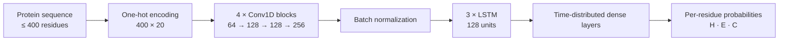

# HelixScope — CNN–LSTM Protein Secondary Structure Prediction

[](https://github.com/jovin11/helixscope/actions/workflows/ci.yml)
[](https://www.python.org/)
[](https://www.tensorflow.org/)
[](https://flask.palletsprojects.com/)

HelixScope is an end-to-end research prototype that predicts three-state (Q3)
protein secondary structure directly from an amino-acid sequence. A hybrid
CNN–LSTM learns local residue motifs and longer-range sequence context, then
assigns each position to **helix (H)**, **sheet (E)**, or **coil (C)**.

The repository includes the trained Keras model, PDB data-preparation research,
a versioned JSON API, command-line inference, a responsive visualization, tests,
CI, and container deployment.

> This is an educational research project, not a clinical or laboratory tool.
> Predictions should be validated with established methods and experimental data.

## Highlights

- **Residue-level inference** with per-position confidence values
- **Hybrid model** with four 1D convolution blocks and three stacked LSTMs
- **Input safety** for plain sequences and single-record FASTA, with actionable errors
- **Production-friendly loading**: TensorFlow initializes lazily and only once
- **Two interfaces**: an interactive browser visualization and a JSON API
- **Reproducible engineering** with typed modules, dependency groups, tests, CI,
  health checks, CLI support, and Docker
- **Research provenance** through the original PDB parsing and model artifacts

## Demo

Paste a sequence, run inference, and inspect both the aggregate class distribution
and the aligned residue-by-residue prediction. Color intensity reflects model
confidence.

| Label | Structure | Visualization |
|:---:|---|---|
| `H` | α-helix | <span style="color:#E04A3F"> ■ Coral Red </span> |
| `E` | β-sheet | <span style="color:#2B6CB0"> ■ Blue </span> |
| `C` | Coil / other | <span style="color:#718096"> ■ Slat e</span> |


## Architecture



The convolution stack identifies short-range sequence patterns. The recurrent
stack carries information across positions, and a time-distributed classifier
produces one probability vector for each residue. Inputs are padded to the saved
model shape of `(400, 20)` and predictions are trimmed back to the input length.

## Quick start

### 1. Create an environment

Python 3.9–3.12 is supported.

```bash
git clone https://github.com/jovin11/helixscope.git
cd helixscope
python -m venv .venv
source .venv/bin/activate
python -m pip install --upgrade pip
python -m pip install -e ".[ml]"
```

### 2. Run the web application

```bash
python python_service/app.py
```

Open [http://127.0.0.1:5001](http://127.0.0.1:5001). The bundled
`best_model_v2.keras` is used by default and loaded on the first request.

### 3. Predict from the command line

```bash
pssp-predict "MKTIIALSYIFCLVFADYKDDDDK"
pssp-predict "MKTIIALSYIFCLVFADYKDDDDK" --json
```

## API

### `POST /api/v1/predict`

```bash
curl --request POST http://127.0.0.1:5001/api/v1/predict \
  --header "Content-Type: application/json" \
  --data '{"sequence":"MKTIIALSYIFCLVFADYKDDDDK"}'
```

Example response (confidence values abbreviated):

```json
{
  "sequence": "MKTIIALSYIFCLVFADYKDDDDK",
  "prediction": "CCCHHHHHHHHHHHHCCCCCCCCC",
  "summary": {
    "length": 24,
    "mean_confidence": 0.7412,
    "class_counts": {"helix": 12, "sheet": 0, "coil": 12}
  }
}
```

The original `POST /predict` endpoint and its `input_data` field remain available
for backward compatibility. `GET /health` reports application and model state
without loading TensorFlow.

Common status codes:

| Code | Meaning |
|---:|---|
| `200` | Prediction completed |
| `400` | Request is not a valid JSON object |
| `413` | Request body exceeds the 64 KiB service limit |
| `422` | Sequence is empty, too long, or contains unsupported residues |
| `503` | Configured model file is unavailable |

## Configuration

Use `.env.example` as a reference and export values in your runtime environment:

| Variable | Default | Purpose |
|---|---|---|
| `PSSP_MODEL_PATH` | `best_model_v2.keras` | Saved Keras model path |
| `PSSP_MAX_SEQUENCE_LENGTH` | `400` | Maximum accepted residues |
| `PSSP_HOST` | `127.0.0.1` | Development server host |
| `PSSP_PORT` | `5001` | Development server port |
| `FLASK_DEBUG` | `0` | Enable Flask debug mode locally |

Do not raise the maximum length above 400 without exporting a compatible model.

## Development

The lightweight test environment intentionally omits TensorFlow; inference is
tested through an injected model double, keeping CI fast and deterministic.

```bash
python -m pip install -e ".[dev]"
make check             # lint + test
make format            # format maintained Python modules
```

To train or fine-tune, install the optional ML dependencies. Prepare NumPy
feature and label arrays with `pssp_model.preprocessing`, then pass them to
`pssp_model.training.train_model` or `fine_tune_model`. Architecture experiments
belong in `pssp_model.model.build_model`.

```bash
python -m pip install -e ".[ml,dev]"
```

## Docker

```bash
docker build -t helixscope .
docker run --rm -p 5001:5001 helixscope
```

The image includes only the serving code and current model. The large PDB data
snapshot and superseded checkpoints are excluded from the build context.

## Project layout

```text
.
├── best_model_v2.keras          # current trained model
├── data/pdb_ids.txt             # tracked manifest for the PDB research dataset
├── docs/MODEL_CARD.md           # intended use, training, and limitations
├── pdb_files/                   # downloaded/generated PDB research data (ignored)
├── public/
│   ├── static/                  # browser behavior and visual design
│   └── templates/               # Flask interface
├── python_service/
│   ├── app.py                   # API factory and HTTP routes
│   ├── cli.py                   # command-line entry point
│   └── pssp_model/
│       ├── model.py             # CNN-LSTM architecture definition
│       ├── preprocessing.py     # sequence and Q3 encoding helpers
│       ├── inference.py         # lazy model loading and prediction flow
│       └── training.py          # training and fine-tuning entry points
├── scripts/download_pdb.py      # reconstructs pdb_files/ from data/pdb_ids.txt
├── tests/                       # unit and API tests
├── Dockerfile
└── pyproject.toml
```

## Model and data notes

The checked-in model was saved with Keras 3.5 in August 2024. The original
experiment notes report approximately **72–73% validation accuracy**. That number
is retained as historical context, not presented as a reproducible benchmark:
the repository does not include the exact split manifest or a padding-aware,
held-out evaluation report.

Training labels were derived from PDB `HELIX` and `SHEET` records, with remaining
positions assigned to coil. The tracked `data/pdb_ids.txt` manifest records the
2,234 PDB identifiers used by the local research snapshot. The actual
`pdb_files/` directory contains generated/downloaded research data and is
intentionally excluded from Git; serving predictions does not require it.

To reconstruct the local PDB files from the repository root, run:

```bash
python scripts/download_pdb.py
```

Rerunning the command skips existing non-empty files by default. To replace
existing files, pass `--overwrite`:

```bash
python scripts/download_pdb.py --overwrite
```

See the [model card](docs/MODEL_CARD.md) for the complete limitations and
recommended evaluation work.

## Roadmap

- Rebuild deterministic train/validation/test manifests with homology-aware splits
- Report padding-masked Q3, per-class F1, SOV, and confidence calibration
- Compare against a bidirectional recurrent baseline and protein language models
- Export a smaller serving format and add batched prediction
- Move the PDB snapshot to versioned external data storage

Contributions that improve reproducibility, evaluation, or biological validation
are especially welcome.
